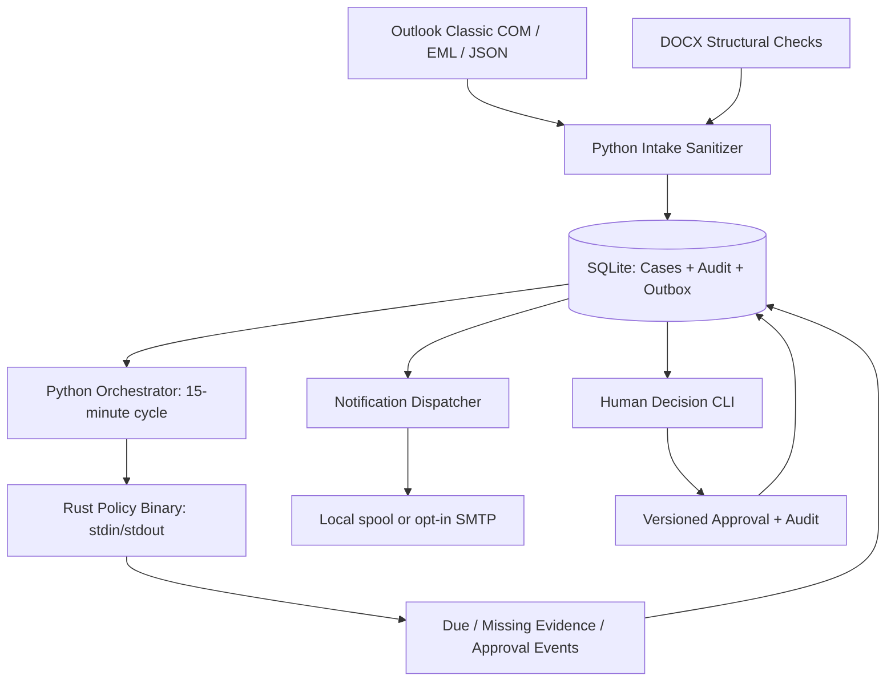

# Education AI Workflow v2 — Python + Rust Technical Design

**Version:** 0.2.0 | **Date:** 2026-10-19 | **Audience:** technical integrators and Japan school administration

## 1. Goal

Run repetitive intake, deadline tracking, evidence checks, notifications, and review preparation with deterministic, local-first logic. Humans approve only irreversible/externally visible actions, personnel decisions, disputed/insufficient evidence, or ambiguous dates. No autonomous HR judgments or unapproved data exfiltration.

## 2. Component boundaries



**Python owns**: adapters, parsing, timezone, storage, retries, audit, notification delivery, task scheduling, human confirmation. `stdlib` only for core. It has no unrestricted AI content analysis in v2.

**Rust owns**: pure policy evaluation for classified cases and their due state. Protocol v1 is a versionable, UTF-8 hex-delimited line stream, no JSON dependency and no network access.

**AI (future, optional)**: an organization-approved local model can suggest a draft or extraction with evidence, never approve the result or send personal data externally without authorization. The current release does **not** invoke ChatGPT automatically.

## 3. Workflows and acceptance

| ID | Workflow | Mechanism | Approval / exception | Current status |
|----|----------|-----------|----------------------|----------------|
| WF-01 | Import emails | Python EML read or optional Outlook Classic COM | all NLP deadlines initially unverified | Python tested; COM not tested |
| WF-02 | Classify / assign | classification is explicit in fixture, restrictive default for email | owner review needed on ambiguous entries | partial |
| WF-03 | Deadline scheduler | Windows Task Scheduler every 15 min + Rust rules | humans only verify ambiguous due | Python tested; Windows task untested |
| WF-04 | Reminders & escalation | D-3, D-1, day 0, overdue daily, restricted masking | notifications may be automatic after IT-approved channel config | file spool tested; SMTP not live-tested |
| WF-05 | DOCX check | local structural phrase checklist, document checksum | pedagogical/legal content still human-reviewed | Python tested |
| WF-06 | Regulation and HR evidence | flags missing evidence reference | hold on missing evidence; no AI scoring or rule interpretation | gating tested; semantic analysis not implemented |
| WF-07 | Human approve/reject | compare-and-swap version, user allowlist, typed confirmation | ALWAYS human for approvals | Python tested; production SSO missing |
| WF-08 | Monitoring & recovery | durable SQLite outbox, no blind SMTP retry on unknown outcome | operator must reconcile uncertain delivery | Python tested |

## 4. Case record v1

```json
{
  "case_id":"EDU-002","kind":"DOCUMENT","data_class":"INTERNAL",
  "safe_title":"架空の教案","owner":"reviewer@example.invalid",
  "status":"READY_FOR_APPROVAL","approval_status":"PENDING",
  "due_at":"2026-10-20T16:00:00+09:00","due_verified":true,
  "evidence_ref":"DOC-REFERENCE-ID"
}
```

Classifications: PUBLIC, INTERNAL, CONFIDENTIAL, RESTRICTED. Status flow:
`NEW -> TRIAGE -> DRAFT -> READY_FOR_APPROVAL -> APPROVED/REJECTED -> (external executor after approval, not in v2) -> COMPLETED`.
The state machine is not yet an enforceable role-checked transition matrix for arbitrary updates; v2 exposes only narrow approved CLI transitions.

Case revision increases on every approved local state update; stale queued alerts are marked STALE. Alerts are deduplicated per case, rule, day and revision, hashed into a stable SHA-256 id.

## 5. Rust wire protocol

Input line: `CASE\tHEX_UTF8_ID\tKIND\tCLASS\tSTATUS\tDAYS_TO_DUE\tDUE_STATE\tEXPIRED_FLAG\tHAS_EVIDENCE\tAPPROVAL_STATUS`.

Output line: `EVENT\tHEX_UTF8_ID\tRULE_CODE\tSEVERITY`.

`DAYS_TO_DUE` and `EXPIRED_FLAG` are calculated using timezone-aware values in Python and never parsed from arbitrary email by Rust. Rust parses all fields strictly. Any nonzero binary exit **blocks the whole cycle**; no silent Python fallback when configured as Rust.

Important distinction: Rust rules check that `evidence_ref` exists, not whether the underlying law is valid or the document is authentic.

## 6. Notification timing (Japan)

- D-3: INFO reminder once per calendar day/revision
- D-1: WARNING reminder
- D0 before due time: WARNING due today
- D0 past due time: WARNING overdue today
- D<0: CRITICAL overdue daily
- Missing deadline/date unverified: WARNING verification daily
- HR, regulation, document with missing evidence reference: CRITICAL hold; never emit APPROVAL_PENDING
- Waiting for manager approval with evidence present: WARNING pending

If a cycle misses D-3 due to PC shutdown, the event is not backfilled retroactively. Missed deadlines are surfaced by daily overdue alerts when the PC runs again.

## 7. Human approval boundaries

The system **must not autonomously**:
- make personnel appraisal scores, discipline, appointments or final comments;
- send replies/submit documents or change official calendar without recorded approval;
- invent legislative citations, legal validity, or observed facts;
- automatically decide uncertain dates from natural-language mail;
- upload sensitive content to a generative AI provider.

Local v2 approval requires the OS account appear in `EDU_APPROVER_USERS` and typed `APPROVE <ID>` / `REJECT <ID>`. This is **not** tenant-grade identity proof: a managed-identity approval service and RBAC are required before deploying to a school-wide multi-user environment.

## 8. Data safety

- Defaults email records to RESTRICTED and stores only hashed source id, not message text, subject or sender.
- The event message for CONFIDENTIAL/RESTRICTED cases contains only a generic title and internal id.
- DB still holds other case attributes; protect file using NTFS ACL, full-disk encryption and account-specific directory (do not use public folders).
- Do not use this prototype with real personal data without privacy review, host hardening, backup and retention approval.
- Separate Microsoft Graph delegated OAuth route is required for new Outlook; classic Outlook COM is not available there.

## 9. Production boundary & future design

### Windows user account, no admin rights

- Run Rust as a locally compiled `.exe` in a user-owned directory.
- Python portable/venv environment; Windows Task Scheduler task under the same logged-in user.
- Outlook Classic adapter uses `pywin32` only when explicitly enabled and authorized, with a logged-in Outlook profile. New Outlook requires Microsoft Graph with registration/consent.
- Notification channel is explicit: local durable files by default; user must enable approved SMTP and allowlist for actual email notifications. Creating a local file alone does not prove that anybody saw it.
- No native SSO, mail send, To Do sync, LLM, policy-document semantic validation, or organization-wide multitenancy in v2.

### Optional phase v3

- Microsoft Graph delegated consent; delta sync and refresh token stored in OS credential vault.
- User-facing Japanese dashboard with authenticated approval, metrics and queue.
- Audit integrity anchoring, controlled document version registry and citation/quote provenance.
- Local LLM with approved data classification routing and human validation.
- Signed binaries, WDAC policy compliance, endpoint monitoring, rollout/rollback, tests on Windows.

## 10. Traceability, sign-off

| Requirement | Evidence | Criterion |
|-------------|----------|----------|
| No forgotten deadlines | `tick` + `alerts` | D-3/D-1/D0/overdue observable |
| No repeat push after rerun | test suite | same case/revision/day produces zero new alert |
| No unverified HR approval | `decide` + tests | lack of evidence or unverified date denies approval |
| No sensitive name in alerts | tests | RESTRICTED title absent in outbound message |
| No automatic HR decision | code review | no auto-approve executor/API exists |
| Fail safely without Rust | test suite | `tick --backend rust` fails nonzero if binary absent |
| True Rust execution | `cargo test`, compiled Rust E2E | **UNVERIFIED on this authoring host** |
| Microsoft Office live E2E | tenant and Windows host tests | **BLOCKED pending permissions/environment** |
